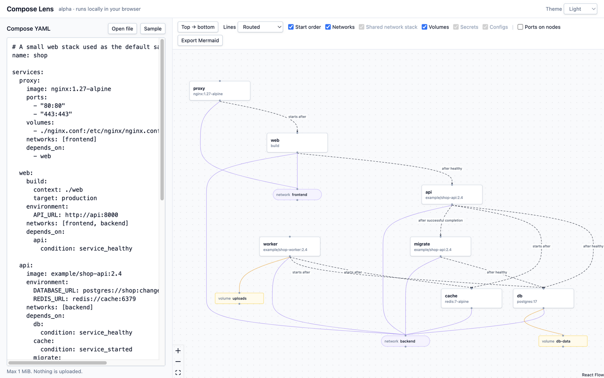
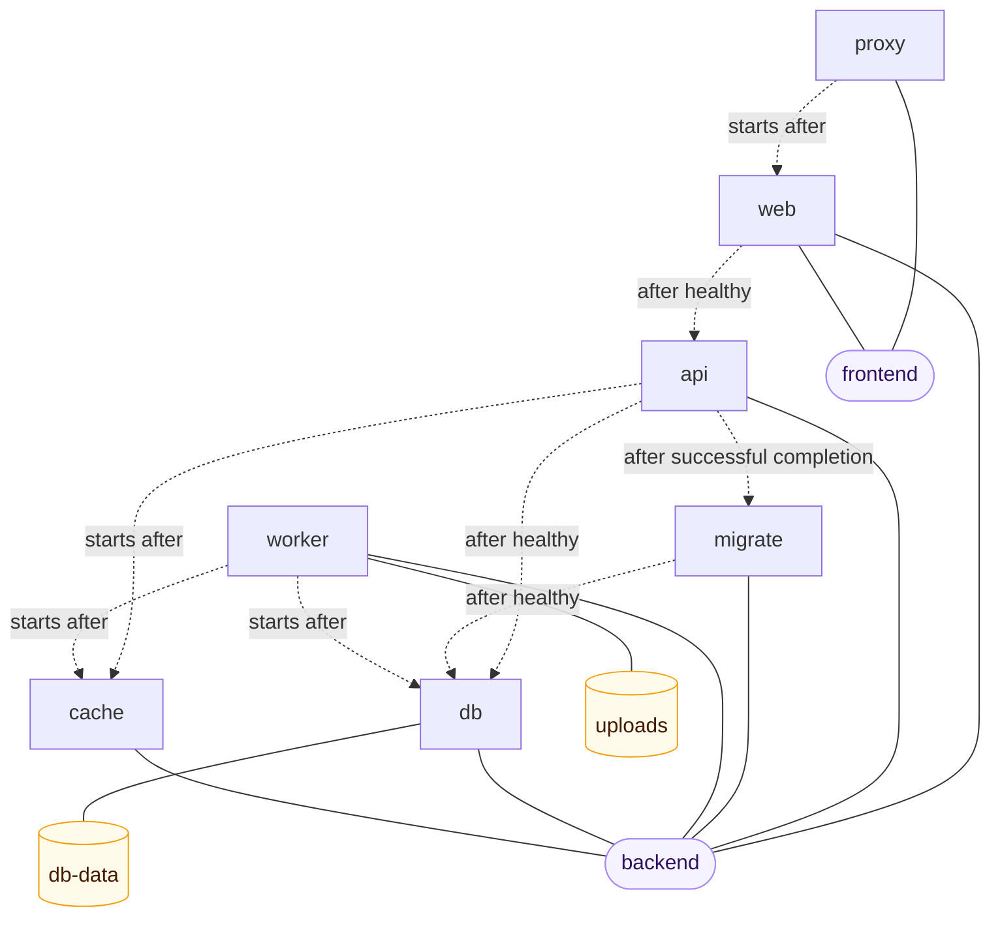

# Compose Lens

[한국어](README.md) | **English**

**See the structure of a Docker Compose file at a glance, right in your browser.**

Paste or drop a `compose.yaml` to see its services, networks, and volumes as a graph, get configuration problems flagged, and export a Mermaid diagram for your README. Everything runs in your browser.

**[Open the web app →](https://sik-yong.github.io/compose-lens/)**



> **Status: alpha (v0.1.0).** What's supported is in the [support matrix](docs/support-matrix.md); the design is in the [PRD](docs/PRD.md) (Korean).

## Features

- Load a Compose file by upload, drag and drop, or paste
- Interactive graph: services, networks, and named volumes, with auto layout, drag, and zoom
- Detail panel per service: image, build, ports, networks, volumes, dependencies, and environment keys (values hidden)
- Diagnostics:
  - YAML syntax errors with line and column
  - Missing service, network, and volume references
  - Potential host port conflicts within the file (protocol, IP, and ranges aware)
  - Unresolved `${VARIABLES}` and unsupported fields
- Mermaid export: copy, copy for README, or save as `.mmd`. Diagrams over Mermaid's default render limits (500 edges, 50,000 characters) may not render on GitHub; the app warns you and never truncates the export.

## Accuracy first

- It only states what the file configures. `depends_on` is shown as start order, never as traffic. Sharing a network means "on the same network in this configuration", not "talks to".
- It doesn't guess. Unresolved variables, external resources, and unsupported fields are labeled, not silently filled in or ignored.
- What's supported and what isn't is written down in the [support matrix](docs/support-matrix.md).

## Mermaid example

The [example Compose file](examples/basic/compose.yaml), exported. GitHub renders it as is.



## Privacy

- **Local only:** Your Compose file is never uploaded. No external CDNs, fonts, or analytics; the deployed app blocks outside connections with a CSP.
- **Masked values:** Values of `environment` and `build.args` never appear in the detail panel, diagnostics, or exports. The input editor still shows the text you pasted.
- **Limits:** `command`, `entrypoint`, `labels`, and `healthcheck.test` are not displayed. Secrets inside displayed values, such as image references or URLs, are not detected. See the [masking boundary](docs/support-matrix.md#masking-boundary).

## Out of scope

Connecting to Docker Engine, container status or metrics, starting or stopping containers, Kubernetes manifests, and inferring real network traffic.

## Roadmap

Markdown docs export, PNG/SVG export → more diagnostics → CLI for CI → Compose diff → `.env` interpolation, multi-file merge, profiles → VS Code extension

## Project layout

```
apps/web/        React web app
packages/core/   Parser, diagnostics, graph and Mermaid conversion (no UI deps)
examples/        Sample Compose files
docs/            PRD, support matrix, verification notes
```

## Development

Requires Node.js 22.12+, 24, or 26+.

```sh
npm install
npm run dev     # start the web app
npm run check   # typecheck, test, and build all workspaces
```

## Contributing

Issues and pull requests are welcome. Please read [CONTRIBUTING.md](CONTRIBUTING.md) first.

## License

[MIT](LICENSE)
