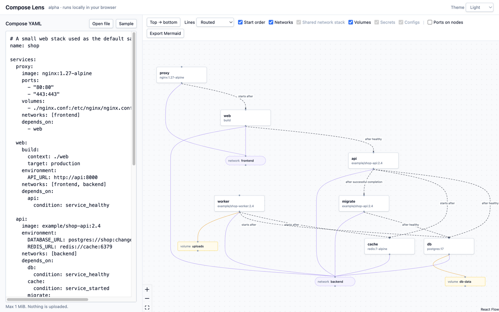
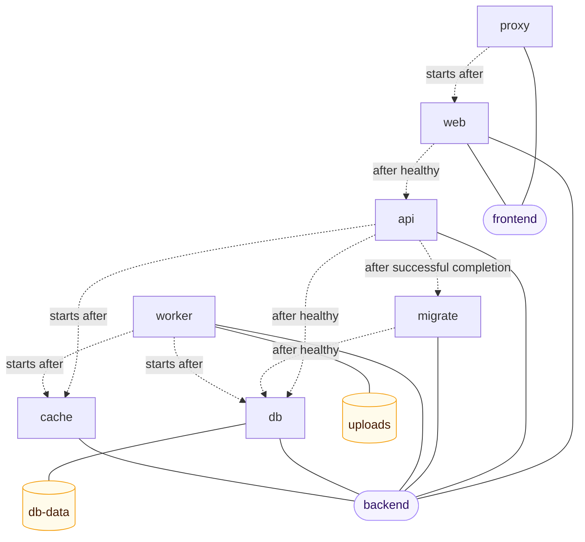

# Compose Lens

**한국어** | [English](README.en.md)

**Docker Compose 파일의 구조를 브라우저에서 한눈에.**

`compose.yaml`을 붙여넣거나 끌어다 놓으면 서비스·네트워크·볼륨을 그래프로 보여 주고, 설정 문제를 알려 주며, README에 바로 넣을 수 있는 Mermaid 다이어그램을 내보냅니다. 모든 처리는 브라우저 안에서만 이루어집니다.

**[웹앱 열기 →](https://sik-yong.github.io/compose-lens/)**



> **상태: alpha (v0.1.1).** 지원 범위는 [support matrix](docs/support-matrix.md)(영문)에, 설계는 [PRD](docs/PRD.md)에 있습니다.

## 기능

- 파일 업로드·끌어다 놓기·붙여넣기로 Compose 파일 불러오기
- 인터랙티브 그래프: 서비스, 네트워크, named volume, secret, config를 자동 배치하고 드래그·확대·축소 지원
- 보기 옵션: 관계별 표시/숨김(시작 순서, 네트워크, 네트워크 공유, 볼륨, secret, config), 노드에 호스트 포트 표시, 연결선 스타일(노드를 피해 가는 경로, 직각, 곡선, 직선), 라이트·다크 테마
- 서비스 상세 패널: 이미지, 빌드, 포트, 네트워크(별칭·고정 IP 포함), 볼륨, 의존 관계, secret, config, 환경변수 키(값은 숨김)
- 진단:
  - 줄·열 정보가 있는 YAML 문법 오류
  - 존재하지 않는 서비스·네트워크·볼륨·secret·config 참조
  - 이 파일 안에서의 호스트 포트 충돌 가능성 (프로토콜·IP·범위 고려), 고정 포트와 겹치는 포트 범위 할당
  - 해석되지 않은 `${VARIABLES}`, 지원하지 않는 필드
- Mermaid 내보내기: 복사, README용 복사, `.mmd` 파일 저장. 지금 화면에 보이는 관계 그대로 내보내고, 숨긴 관계는 주석으로 남깁니다. Mermaid 기본 렌더링 한도(엣지 500개, 50,000자)를 넘으면 GitHub에서 렌더링되지 않을 수 있어 경고를 보여 줍니다. 내보내기 결과는 자르지 않습니다.

## 정확성 원칙

- 파일에 실제로 설정된 것만 말합니다. `depends_on`은 시작 순서로 보여 주고, 트래픽으로 표현하지 않습니다. 같은 네트워크에 있다는 것은 "설정상 같은 네트워크"이지 "서로 통신함"이 아닙니다.
- 추측하지 않습니다. 해석되지 않은 변수, 외부 리소스, 지원하지 않는 필드는 조용히 채우거나 무시하지 않고 그렇다고 표시합니다.
- 무엇을 지원하고 무엇을 지원하지 않는지 [support matrix](docs/support-matrix.md)에 적어 둡니다.

## Mermaid 예시

[예제 Compose 파일](examples/basic/compose.yaml)을 내보낸 결과입니다. GitHub에서 그대로 렌더링됩니다.



## 개인정보

- **로컬 처리:** Compose 파일을 업로드하지 않습니다. 외부 CDN·폰트·분석 도구를 쓰지 않고, 배포본은 CSP로 외부 연결을 막습니다.
- **값 가리기:** `environment`와 `build.args`의 값은 상세 패널·진단·내보내기 어디에도 나오지 않습니다. 입력 편집창에는 붙여넣은 원문이 그대로 보입니다.
- **한계:** `command`, `entrypoint`, `labels`, `healthcheck.test`는 표시하지 않습니다. URL 안의 계정 정보(`https://user:token@…`)는 `***`로 바꿉니다. 그 밖에 이미지 이름이나 경로처럼 표시되는 값 안의 비밀 정보는 탐지하지 않습니다. 자세한 내용은 [마스킹 경계](docs/support-matrix.md#masking-boundary)를 참고하세요.

## 범위 밖

Docker Engine 연결, 컨테이너 상태·리소스 조회, 컨테이너 시작·중지, Kubernetes 매니페스트, 실제 네트워크 트래픽 추론.

## 로드맵

Markdown 문서 내보내기, PNG/SVG 내보내기 → 진단 확장 → CI용 CLI → Compose 비교 → `.env` 변수 치환, 여러 파일 병합, profiles → VS Code 확장

## 프로젝트 구조

```
apps/web/        React 웹앱
packages/core/   파서, 진단, 그래프·Mermaid 변환 (UI 의존성 없음)
examples/        예제 Compose 파일
docs/            PRD, support matrix, 검증 기록
```

## 개발

Node.js 22.12 이상, 24, 26 이상이 필요합니다.

```sh
npm install
npm run dev     # 웹앱 실행
npm run check   # 모든 워크스페이스의 타입 검사, 테스트, 빌드
```

## 기여

이슈와 PR을 환영합니다. [CONTRIBUTING.md](CONTRIBUTING.md)를 먼저 읽어 주세요.

## 라이선스

[MIT](LICENSE)
